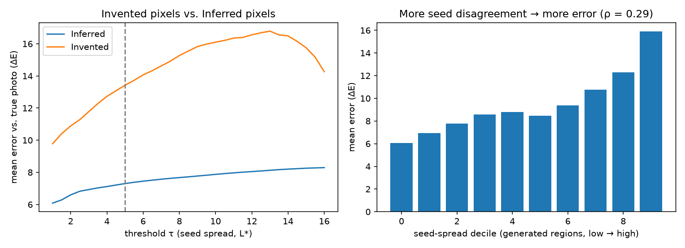

# Cold Case

**Old photos, restored. Every guess on the record.**

AI photo restorers don't recover lost detail; they invent it, and never say where. Cold Case repairs
damaged historical photos and labels every pixel **Real** (untouched), **Rebuilt** (every repair
attempt agreed) or **Invented** (the attempts disagreed, so it's a guess), then signs that record into
the file as a C2PA Content Credential.

**Live site:** https://cold-case-t1s8.onrender.com · Built at Banana Hacks 2026 by Siddharth Tumati and Anish Meruva.



## How it works

```
 scan ──► 1. damage segmenter ──► 2. multi-seed inpainting ──► 3. disagreement map ──► 4. faces ──► 5. receipt
          (U-Net, trained by us;   (thin cracks: classical fill;  (per-pixel spread in   (CodeFormer   (JSON manifest,
           person reviews mask)     thick damage: SDXL × 8 seeds)  CIELAB → Real /        per seed;     C2PA-signed
                                                                    Rebuilt / Invented)    3 alternates) into the PNG)
```

1. **Find the damage.** A U-Net (ResNet-34) we trained on our own procedural damage generator, then fine-tuned on 15 hand-labelled real scans. Uploads show its proposed mask in a brush so a person can fix it; the receipt records whether they did.
2. **Restore several times.** Thin damage is filled classically; thick damage is cropped, inpainted by SDXL with 8 seeds (4 for live uploads), tone- and grain-matched, and composited back. **Pixels outside the mask are copied byte for byte** (automated test, 8/8).
3. **Measure disagreement.** Lightness spread across seeds, measured before face restoration: low spread = Rebuilt, high spread = Invented.
4. **Faces.** CodeFormer per seed at an adjustable fidelity; where a face was invented, the three most different versions are shown side by side.
5. **Sign the receipt.** Every stage, setting, region and confidence goes into a manifest embedded as a C2PA Content Credential.

## Results (all from scripts in this repo)

| Measure | Result |
|---|---|
| Damage detection, synthetic held-out | IoU 0.898 |
| Damage detection, real photos (synthetic-only training) | IoU 0.007 |
| Damage detection, real photos (after real fine-tune, 3-fold CV) | **IoU 0.182** (folds 0.156 / 0.252 / 0.153) |
| Do the labels mean something? | Invented pixels are **1.8× further from the truth** than Rebuilt (13.4 vs 7.3 ΔE; Spearman ρ 0.29) |
| Untouched pixels changed | **0** (automated test with models replaced by noise; every demo run) |
| SDXL steps (20 / 30 / 40) vs a known true face | face ΔE 8.71 / 8.61 / 8.62: under 1.2% apart, so we use 20 |
| Speed (M5 Pro, MPS) | ~15 s per SDXL seed; a typical upload in ~80 s |

Limitations, honestly: real-damage detection is still weak (hence the human mask review); seed agreement
is a warning signal, not proof of correctness; CodeFormer is non-commercial; receipts use a test certificate.

## Run it

```bash
# backend (Apple silicon or CUDA). Model weights go in weights/ (not in git).
cd backend
python3.11 -m venv .venv-gpu && source .venv-gpu/bin/activate
pip install -r requirements-gpu.txt
ln -s ../weights weights && ln -s ../third_party third_party
SEG_WEIGHTS=weights/seg_v4_best.pth uvicorn api:app --port 8000      # site + API on :8000

# render the demo cases at 8 seeds, then ship offline copies with the site
python precompute_demos.py && python export_static_demos.py

# frontend dev server (proxies the API on :8000)
cd ../frontend && npm install && npm run dev
```

No GPU? `CV_PIPELINE=stub uvicorn api:app --port 8000` runs a fake pipeline for UI work (the site shows a
yellow Test mode bar). Hosted: the static site on Render calls the Mac through a Cloudflare tunnel
(`VITE_API_URL`) and falls back to the bundled demo cases when the Mac is offline. More in
[WEB_README.md](WEB_README.md).

## Repo map

| Path | What |
|---|---|
| `backend/pipeline/` | the restoration pipeline (segment, inpaint, invention map, faces, manifest, C2PA) |
| `backend/api.py`, `restore_hook.py` | web API: job queue, cache, mask proposal, result files |
| `training/` | damage generator, segmenter training, real fine-tune, evaluations, document experiment |
| `frontend/` | React + Vite + Tailwind site |
| `docs/` | calibration chart, IoU results, user-study materials |

## Licenses

Cold Case is a free, non-commercial tool. Face restoration uses CodeFormer (S-Lab License 1.0,
non-commercial use only); a commercial deployment should swap in GFPGAN (Apache 2.0). Inpainting uses
SDXL Inpainting 0.1 (CreativeML OpenRAIL++-M). C2PA manifests are signed with the public c2pa-python test
certificate and show as untrusted; they demonstrate the format, not a trusted signer. Demo photos are public
domain or have no known copyright restrictions; credits are in `backend/demos/demos.json`.
